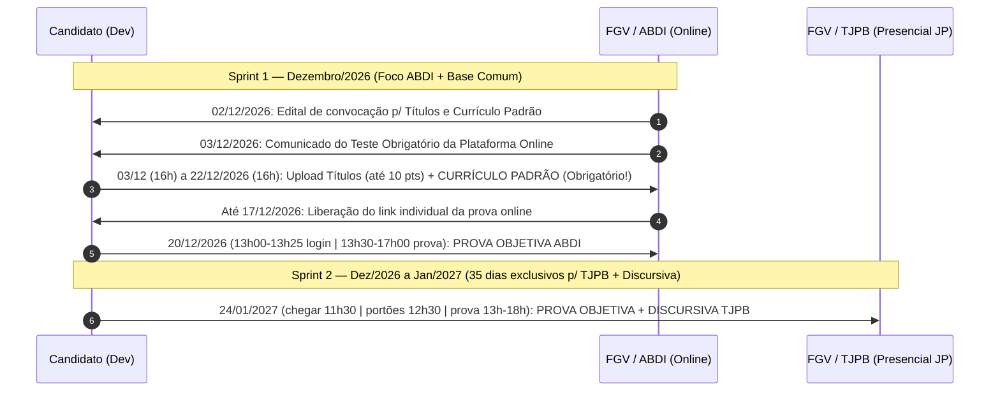

# Guia Mestre de Estudo & Estratégia de Prova — TJPB × ABDI (Dev de Software)

> **Perfil de Documentação:** `qualquer` (Extração estruturada focada na prova e no conteúdo programático)
> **Status do Candidato:** Já inscrito e pago em ambos os certames (`[OBSERVADO]`).
> **Alvo:** `Analista Judiciário – TI: Desenvolvimento de Sistemas` (**TJPB**) + `API – Desenvolvimento de TI` (**ABDI**) · Modalidade: **Cota Negros (PN/PPP) + Ampla Concorrência** `[OBSERVADO]`.

---

## 1. Raio-X das Duas Provas (Lado a Lado)

| Dimensão | ABDI (`API – Desenvolvimento de TI`) | TJPB (`Analista TI – Desenvolvimento de Sistemas`) |
| :--- | :--- | :--- |
| **Banca** | **FGV** `[OBSERVADO]` | **FGV** `[OBSERVADO]` |
| **Data e Horário da Prova** | **20/12/2026 (domingo)** · **13h30 às 17h00** (3h30 de prova) `[OBSERVADO]` | **24/01/2027 (domingo)** · **13h00 às 18h00** (5h de prova) `[OBSERVADO]` |
| **Modalidade de Aplicação** | **Online (em casa)** com webcam + microfone + navegador seguro FGV `[OBSERVADO]` | **Presencial em João Pessoa/PB** (portões fecham **12h30**) `[OBSERVADO]` |
| **Vagas (Dev)** | **2 imediatas** (1 AC · **1 PN**) + **16 CR** (10 AC · **4 PN** · 1 Ind · 1 PCD) `[OBSERVADO]` | **10 imediatas** (6 AC · **3 PN** · 1 PCD) + Cadastro de Reserva `[OBSERVADO]` |
| **Remuneração e Jornada** | **R\$ 16.034,70** + benefícios · **40h/sem** · CLT · Brasília/DF `[OBSERVADO]` | **R\$ 11.526,14** (R\$ 7.526,14 venc. + R\$ 2.200 alim. + R\$ 1.800 saúde) · **30h/sem** (`[RETIFICADO]`) · Estatutário · PB `[OBSERVADO]` |
| **Composição da Nota Final** | **Objetiva (25 pts)** + **Títulos/Exp (10 pts)** + **Entrevista (15 pts)** = **50 pts** `[OBSERVADO]` | **Objetiva (60 pts)** + **Discursiva Estudo de Caso (40 pts)** = **100 pts** *(Sem títulos!)* `[OBSERVADO]` |
| **Peso de Conhecimentos Específicos** | **52% da Objetiva** (20q × 0,65 = 13 pts de 25) `[INFERIDO]` | **80% da Nota Total do Concurso!** (40 pts Objetiva + 40 pts Discursiva = 80 de 100 pts) `[INFERIDO]` |
| **Nota Mínima na Objetiva** | **30 acertos de 60 (50%)** E **não zerar nenhuma das 3 áreas** `[OBSERVADO]` | **Ampla:** 60% (**36 pts**) **Cota PN:** 48% (**28,8 pts → 29 questões**) `[OBSERVADO]` |
| **Corte p/ Etapa Seguinte** | Vão p/ Entrevista os classificados até `Vagas + CR`: **Top 11 AC** e **Top 5 PN** (cotista no Top 11 AC não consome vaga PN!) `[OBSERVADO]` | **Ampla:** corrige discursiva até **100ª posição**. **Cota PN (2ª Retificação):** **TODOS os cotistas aprovados na objetiva (≥29 pts) têm a discursiva corrigida** (sem cláusula de barreira!) `[OBSERVADO]` |

---

## 2. Calendário Operacional Pós-Inscrição (O que falta fazer)

> [!IMPORTANT]
> **3 Compromissos Obrigatórios pós-inscrição (`[OBSERVADO]`):**
> 1. **03/12 a 22/12/2026 (ABDI — Item 12.3.1):** Enviar o **Currículo Padrão (Anexo IV)** e os comprovantes de **Títulos/Experiência** no site da FGV. Não enviar o currículo padrão nesse prazo **elimina do concurso da ABDI**, mesmo antes do resultado da prova!
> 2. **A partir de 03/12/2026 (ABDI — Item 10.3.1):** Realizar o **Teste Obrigatório da Plataforma** no mesmo computador, webcam, microfone e conexão que usará no dia 20/12/2026.
> 3. **20/12/2026 e 24/01/2027:** Ter em mãos **documento de identidade original FÍSICO com foto** (CNH/RG digital no celular **reprova na hora** nos dois concursos — item 10.6.3 ABDI e item 11.5 TJPB).

---

## 3. Matemática da Aprovação: Onde estão os Pontos?

### 3.1. Distribuição de Pontos — ABDI (Prova em 20/12/2026)
| Bloco | Disciplina | Questões | Valor/Q | Total | % da Objetiva |
| :--- | :--- | :---: | :---: | :---: | :---: |
| **Gerais** | Língua Portuguesa | 8 | 0,30 | 2,4 pts | 9,6% |
| **Gerais** | Raciocínio Lógico | 6 | 0,30 | 1,8 pts | 7,2% |
| **Gerais** | Noções de Informática + Leis (LAI, Marco Civil, LGPD, Lei 12.737) | 6 | 0,30 | 1,8 pts | 7,2% |
| **Institucionais** | Natureza e finalidade dos Serviços Sociais Autônomos (Lei 11.080/04 + Dec. 5.352/05) | 4 | 0,30 | 1,2 pts | 4,8% |
| **Institucionais** | Criação da ABDI e Estatuto Social | 4 | 0,30 | 1,2 pts | 4,8% |
| **Institucionais** | **Regulamento de Licitações e Contratos + Regulamento de Convênios da ABDI** | **8** | **0,30** | **2,4 pts** | **9,6%** |
| **Institucionais** | Código de Ética (Res. 004/22) + Planejamento Estratégico 2024–2029 (Res. 008/23) | 4 | 0,30 | 1,2 pts | 4,8% |
| **Específicos** | **Engenharia de Software, Web/JS/Java/PHP, SQL, REST, Ágil/DevOps, Testes/OWASP, SLA** | **20** | **0,65** | **13,0 pts** | **52,0%** |
| **TOTAL** | — | **60** | — | **25,0 pts** | **100%** |

* **Regra de Ouro na ABDI:** 1 questão de **Conhecimentos Específicos (0,65 pt)** vale mais que **2 questões** de Gerais ou Institucionais (0,30 pt) `[INFERIDO]`. E dentro de Institucionais, **metade dos pontos (10 de 20 questões)** está nos **Regulamentos de Licitações/Contratos/Convênios (8q)** + **Lei 11.080/Decreto 5.352 (8q somando itens 1 e 2)** `[OBSERVADO]`.

---

### 3.2. Distribuição de Pontos — TJPB (Prova em 24/01/2027)
| Etapa / Módulo | Disciplina | Questões | Valor | Total | % do Concurso |
| :--- | :--- | :---: | :---: | :---: | :---: |
| **Objetiva — Módulo I** | Língua Portuguesa (+ Redação Oficial) | 10 | 1,0 | 10,0 pts | 10% |
| **Objetiva — Módulo I** | Raciocínio Lógico-Matemático | 10 | 1,0 | 10,0 pts | 10% |
| **Objetiva — Módulo II** | **Conhecimentos Específicos (Fundamentos TI + Dev de Sistemas)** | **40** | **1,0** | **40,0 pts** | **40%** |
| **Discursiva** | **Estudo de Caso (30 linhas) sobre Conhecimentos Específicos de Dev** | **1** | **40,0** | **40,0 pts** | **40%** |
| **TOTAL** | — | **60 + 1 Disc.** | — | **100,0 pts** | **100%** |

* **Regra de Ouro no TJPB:** **80% da nota final do concurso (80 de 100 pontos)** vem diretamente do conteúdo de **TI / Desenvolvimento de Sistemas** (40 pts na Objetiva + 40 pts no Estudo de Caso Discursivo). Além disso, o **1º critério técnico de desempate** (item 13.1.b) é a maior nota nos **40 pontos de Conhecimentos Específicos da Objetiva** `[OBSERVADO]`.

---

## 4. Mapa de Sinergia: Como Estudar para os DOIS ao Mesmo Tempo

Como a prova da **ABDI é em 20/12/2026** e a do **TJPB é em 24/01/2027** (35 dias depois), a estratégia perfeita é dividir o estudo em **2 Fases**:

### Fase 1 (Até 20/12/2026): Interseção Total (ABDI + TJPB) + Específicos ABDI

#### Bloco A — O que cai na ABDI e TAMBÉM já resolve o TJPB (`[OBSERVADO]`):
1. **Português FGV:** Os itens `1` a `6.4` são **100% idênticos letra por letra** nos dois editais (Interpretação, tipos/gêneros, coesão/conectivos, tempos verbais, classes de palavras, coordenação/subordinação, pontuação, concordância, regência, crase, pronomes átonos e reescrita).
2. **Raciocínio Lógico Proposicional FGV:** Proposições simples/compostas, conectivos, tabelas-verdade, equivalências, negações, diagramas lógicos e argumentação lógica.
3. **Engenharia de Software, Ágil e Requisitos:** Ciclo de vida (SDLC cascata/iterativo), engenharia de requisitos, histórias de usuário, backlog, critérios de aceitação, Scrum e Kanban.
4. **Arquitetura, POO, Web e APIs:** Lógica, estruturas de dados, POO, Padrões de Projeto, Microsserviços, REST, HTTP/HTTPS, JSON/XML, Java, JavaScript, Node.js, HTML5/CSS3 e responsividade.
5. **Banco de Dados Relacional e SQL:** Modelagem relacional, normalização (1FN a 3FN), integridade referencial, SQL (consultas, `JOIN`s, subqueries, DML), transações, índices e otimização de consultas (*query tuning*).
6. **DevOps, Qualidade e Segurança de Software:** Git, GitHub, GitLab, CI/CD, automação de deploy; testes (unitários, funcionais, integração, regressão); code review; desenvolvimento seguro, **OWASP Top 10**, controle de acesso/autenticação/autorização e **LGPD (Lei 13.709/2018)** + **Marco Civil da Internet (Lei 12.965/2014)**.
7. **Gestão de Serviços e Sustentação:** Gerenciamento de incidentes, problemas e mudanças (ITIL), SLA e acompanhamento técnico de contratos de software.

#### Bloco B — Tiro Curto Exclusivo ABDI (Estudar até 20/12/2026):
1. **Conhecimentos Institucionais da ABDI (20 questões = 6,0 pts):**
   * `Lei nº 11.080/2004` (com a `Lei nº 14.440/2022`) e `Decreto nº 5.352/2005` (Serviços Sociais Autônomos + criação da ABDI).
   * `Estatuto Social da ABDI` (Conselho Deliberativo, Conselho Fiscal e Diretoria-Executiva).
   * `Regulamento de Licitações e Contratos da ABDI` + `Regulamento de Convênios da ABDI` (**8 questões!**).
   * `Regulamento de Ética e Conduta (Res. CD 004/2022)` + `Planejamento Estratégico 2024–2029 (Res. CD 008/2023)`.
2. **Delta Técnico e Informática ABDI:**
   * **UML** (item 1.2) e sintaxe/conceitos de **PHP** (item 2.3).
   * Windows 10/11, MS 365 (Word/Excel/PowerPoint/Outlook), LibreOffice (Writer/Calc/Impress), `Lei 12.527/2011 (LAI)` e `Lei 12.737/2012 (Delitos Informáticos)`.

---

### Fase 2 (21/12/2026 a 24/01/2027 — 35 dias): Imersão Total nos Tópicos Avançados do TJPB + Estudo de Caso

Assim que terminar a prova da ABDI em 20/12, você já estará com toda a base afiada e terá **5 semanas inteiras** para dominar os tópicos que só caem no **TJPB** (e que são os principais candidatos a tema da **Discursiva de 40 pontos!**):

1. **System Design & Arquitetura Avançada:**
   * Teorema CAP, PACELC, BASE vs. ACID, gRPC, WebSockets, Mensageria e EDA (**Kafka, RabbitMQ**), Sharding, Cache em camadas e **Redis**, **Circuit Breaker**, Graceful Degradation, **NGINX / HAProxy**, **Clean Architecture**, **DDD** e **SOLID**.
2. **Stack Específica do TJPB (Java Moderno, Python, Frontend, Dart/Flutter & Mobile):**
   * **Java:** Streams, lambdas, records, sealed classes, pattern matching, switch expressions, **virtual threads**, **Spring Boot** e **Hibernate/JPA**.
   * **Frontend & Python:** **TypeScript**, **Angular**, **React**, **Python (FastAPI e Django)**.
   * **Mobile & Flutter:** **Dart**, **Flutter** (Stateless/Stateful, ciclo de vida, **Provider, BLoC, Riverpod, Cubit**, Material/Cupertino, rotas), Android/iOS lifecycle, **SQLite, Room, Hive/Isar, SharedPreferences/NSUserDefaults**, **SSL Pinning**, engenharia reversa e **FCM**.
3. **Cloud-Native, IaC e Observabilidade:**
   * **Docker** (Dockerfile, Compose, volumes, redes), **Kubernetes** (Pods, Deployments, Services, Ingress, ConfigMaps, Secrets), **Terraform** (providers, módulos, `state`), **Zabbix, Prometheus, Grafana, ELK/OpenSearch**, tracing distribuído e APM.
4. **Engenharia de IA, LLMs, Bancos Vetoriais & SDD:**
   * **Desenvolvimento Orientado a Especificações (SDD):** especificação executável e harness de engenharia assistida por IA.
   * **PLN e LLMs:** Tokenização, stemming, lematização, TF-IDF, Embeddings, **Arquitetura Transformer**, Prompt Engineering, **LangChain**, **RAG**, busca vetorial/bancos vetoriais, **Prompt Injection / Jailbreak / Retenção Zero**.
5. **Segurança Avançada, Testes Avançados e UI/UX/Acessibilidade:**
   * **SAML 2.0, OAuth 2.0, OIDC, JWT**, rate limiting; criptografia (**AES, RSA, curvas elípticas**), **PKI e ICP-Brasil**; normas **ISO/IEC 27001, 27002 e 27005**; **COBIT 2019 e ITIL 4**; **APF/IFPUG** e **SAFe**.
   * **TDD**, **SAST, DAST, IAST**, **SonarQube**, **Contract Testing** e **Mutation Testing**.
   * **UI/UX**, **eMAG**, **WCAG 2.1 e 2.2 (POUR — A, AA, AAA)** e atributos **ARIA**.
6. **Governança e Normativos do Poder Judiciário (Fortíssimo para a Discursiva!):**
   * **PDPJ-Br (Res. CNJ 335/2020)**, **MNI (Res. CNJ 91/2009)**, **MInG**, **PJe**, **MoReq-Jus** e **RDC-Arq (Res. CNJ 522/2023)**.
   * **Resoluções CNJ nº 370/2021 (ENTIC-JUD)**, **nº 396/2021 (ENSEC-PJ)**, **nº 468/2022 (Contratações TIC)** e **nº 615/2025 (IA no Judiciário)**.
   * **PDTI do TJPB 2024–2026**.
7. **Matemática do RLM + Redação Oficial:**
   * Conjuntos, razão/proporção, regra de 3, porcentagem, juros simples/compostos, equações/funções/sequências, matrizes/determinantes, probabilidade, combinatória e estatística descritiva; e Redação Oficial (item 6.5 de Português).

---

## 5. Guias Verticalizados por Concurso

- **[01-EDITAL-TJPB-DEV-COMPILADO.md](file:///c:/Users/coliveirar/Desktop/A/docs/01-EDITAL-TJPB-DEV-COMPILADO.md)** — Regras de prova, critérios do Estudo de Caso Discursivo (2ª Retificação) e Checklist completo do TJPB.
- **[02-EDITAL-ABDI-DEV-COMPILADO.md](file:///c:/Users/coliveirar/Desktop/A/docs/02-EDITAL-ABDI-DEV-COMPILADO.md)** — Regras da prova online, pontuação de Títulos/Entrevista e Checklist completo da ABDI.

---

## 6. Notas de Geração e Privacidade (`sensitive-data.md`)

- **Confiança:** **98% `[OBSERVADO]`** nos textos normativos dos editais e retificações, **2% `[INFERIDO]`** nos cálculos de proporção de pontos.
- **Lacunas (`NÃO DETERMINÁVEL A PARTIR DO INPUT`):** Datas exatas de publicação de gabarito, resultado preliminar e convocação para heteroidentificação/entrevista serão publicadas em editais próprios da FGV.
- **Proteção de Dados:** A ofuscação é **mitigação no texto gerado**, não garantia de confidencialidade. Nenhum dado pessoal (CPF/RG) existente na pasta foi incluído nos documentos.
